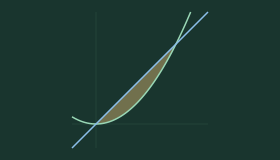
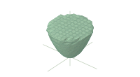

# 积分空间 · 多重积分实验室

把二重积分的平面区域、三重积分的空间立体，变成可以直接观察的图形。

这是一个面向数学分析、高等数学学习的可视化小工具。你可以输入函数或方程，在同一个坐标系中组合多条曲线、多个曲面，调整参数，观察围成区域、截面、投影和积分次序。

**在线体验：[打开积分空间](https://integral-space-wyb-20261023.foggygnome129.chatgpt.site/)** · **[二维实验室](https://integral-space-wyb-20261023.foggygnome129.chatgpt.site/plane.html)**

在线使用无需注册或登录 ChatGPT。不同地区、校园网和运营商的访问情况可能不同；如果原网址无法打开，也可以下载源码在本地运行。

> 如果这个小工具帮助你看懂了积分区域，欢迎点一个 **Star ⭐**！也欢迎分享给正在学多重积分的同学。遇到问题可以提交 Issue，附上能复现问题的方程和截图，帮助这个工具慢慢变得更好。

## 可以做什么

| 功能 | 二维实验室 | 三维实验室 |
| --- | --- | --- |
| 自由输入 | 显式函数、隐式曲线、不等式 | 显式函数、隐式曲面、不等式 |
| 常见图形 | 20 个曲线与区域预设，带预览图 | 23 个曲面与立体预设，带预览图 |
| 多函数组合 | 同一坐标系叠加多条曲线 | 同一坐标系叠加多个曲面 |
| 区域观察 | 围成区域、面积估计、分区选择 | 围成立体、体积估计、分区选择 |
| 分析工具 | 动态截线、坐标轴投影、积分换序提示 | 动态截面、坐标平面投影、交线与关键点 |
| 坐标与视角 | 等比例坐标，平移与缩放 | 拖动旋转、缩放与平移，正交/透视视角 |
| 积分坐标 | 直角坐标的积分次序提示 | 直角、柱、球坐标及雅可比因子 |
| 导出 | PNG 图片、Python 绘图代码 | PNG 图片、Python 绘图代码 |

两套实验室都支持数学排版输入、参数滑块、独立颜色与透明度、图鉴载入与叠加，以及撤销/重做。每个坐标系最多同时添加 12 条曲线或曲面。

| 二维：抛物线与直线 | 三维：抛物面与平面 |
| --- | --- |
|  |  |

上面是图鉴中的预先生成预览图；在线实验室支持进一步调整参数和观察视角。

## 试试这几个例子

每一行分别添加一个函数，不要把多个等式写在同一个输入框里。

### 二维：抛物线与直线围成的区域

```text
y=x^2
y=x
```

载入后观察围成区域，再切换竖直/水平截线，比较 `dy dx` 与 `dx dy` 的积分方向。

### 三维：三个曲面围成的立体

```text
x+y+z=2
z=xy
z=0
```

生成后勾选“显示公共立体”，也可以选择“仅查看立体”，观察靠近原点逐渐变薄的部分。

### 带参数的球面

```text
x^2+y^2+z^2=R^2
```

公式中的 `R` 会自动成为可调参数。拖动滑块即可改变大小。

## 输入与常用操作

- 支持 `sqrt`、括号、次方、分式、加减乘除，以及 `sin`、`cos`、`tan`、`asin`、`acos`、`atan`、`abs`、`exp`、`ln`、`log`、`log10`、`floor`、`ceil`、`min`、`max`、`pow`。
- 可以使用 `x^2`，也支持省略乘号，例如 `2x`、`xy`、`2(x+y)`。角度统一使用弧度。
- 二维只输入 `x^2` 时，默认按 `y=x^2` 处理；三维只输入 `x^2+y^2` 时，默认按 `z=x^2+y^2` 处理。
- 一个输入框只写一个等式或不等式。像 `0<=z<=2` 这样的连写请拆成 `z>=0` 和 `z<=2` 两行。
- 方程默认尝试自动识别围成的有界区域；也可以指定“左侧 ≤ 右侧”“左侧 ≥ 右侧”，或选择仅显示曲线/曲面。
- 隐藏的曲线、曲面以及空白输入框不参与公共区域计算。每个图形可以独立设置颜色和透明度。
- 支持数学输入与文本输入两种模式。排版复杂时可以切换到文本输入，检查括号、乘号和公式错误提示。

| 操作 | 快捷键 |
| --- | --- |
| 生成或更新图像 | `Ctrl + Enter` / `⌘ + Enter` |
| 撤销 | `Ctrl + Z` / `⌘ + Z` |
| 重做 | `Ctrl + Shift + Z` / `⌘ + Shift + Z`，或 `Ctrl + Y` |

## 使用前请了解这些限制

### 图形和积分数值是近似结果

曲面、交点、截线、面积和体积都由数值采样与网格计算得到，**不能代替数学推导、解析积分或有界性的证明**。

遇到间断函数、奇点、极薄结构、特别小的区域，或者绘图范围过大时，结果可能不完整。可以缩小范围、调整参数、提高采样精度，再与题目条件核对。区域接触绘图边界时，也可能只是被当前视窗截断了。

积分限提示覆盖典型模型与可识别的边界，不是通用的符号求解器。任意隐式组合不一定能自动给出完整的解析积分限。柱坐标与球坐标也需要结合具体区域判断是否分段，不能默认角度总是覆盖整周。

球坐标采用：`φ` 从正 `z` 轴量起，`θ` 为绕 `z` 轴的方位角。

### 切换实验室、撤销和恢复编辑的区别

- **切换二维/三维**：保留本次使用中各自的公式、参数、视角与撤销记录。
- **撤销/重做**：用于恢复本次编辑中的公式、参数等操作，最多记录 60 步；连续输入、拖动滑块会合并为一组。
- **刷新或重新打开**：从空白坐标系开始，可主动点击“恢复上次编辑”。
- 编辑备份存储在当前浏览器中，不是云同步。清理浏览器数据、换浏览器或换域名后，之前的记录不会自动带过去。

### Python 导出是当前图形的快照

导出的 `.py` 文件包含公式、可调用的 NumPy 函数、参数、范围、颜色，以及当前已生成图形的网格或轮廓快照。这样可以保留隐式边界、孔洞和多个独立区域。

**修改 Python 文件中的公式或参数，不会自动重新计算其中的图形快照。** 需要在网站中修改、重新生成，再次导出。

运行导出文件需要 Python、NumPy 和 Matplotlib：

```bash
python -m pip install numpy matplotlib
python integral_space_3d.py
```

也可以直接保存图片：

```bash
python integral_space_3d.py --save graph.png --no-show
```

二维导出的文件名为 `integral_space_2d.py`。普通网页绘图本身不需要安装 Python。

### 性能与浏览器

建议使用支持 WebGL、ES Modules 和 Web Workers 的现代浏览器。高采样精度、多曲面和复杂隐式方程会增加计算量；配置较低的设备可以先选择“快速”精度。

公式计算在浏览器本地完成，渲染库、数学编辑器和字体均随项目提供，不需要 API key。网站没有添加公式上传、账号系统或云端编辑同步功能；托管服务可能保留其正常的访问日志。

## 本地运行

安装 Node.js 后，下载源码或克隆仓库：

```bash
git clone https://github.com/WYB-git-0858/integral-space.git
cd integral-space
npm start
```

浏览器打开 **http://127.0.0.1:5173/**。

这个项目是纯静态网站，所需前端库已放在 `dist/vendor` 中，运行网页无需额外执行 `npm install`。请通过 HTTP 服务器访问，**不要直接双击 HTML 文件**，否则浏览器可能拦截模块与 Worker。

## 自己部署

把 `dist` 目录中的文件作为静态网站发布即可：

- 默认首页：`index.html`；二维页面：`plane.html`。
- 保留 `vendor`、字体和两个预览图目录。
- `.js`、`.mjs` 应返回 JavaScript MIME 类型，例如 `text/javascript` 或 `application/javascript`。
- 不需要数据库、服务器端接口、ChatGPT 登录或 API key。
- 自行托管时，配置匿名只读访问。是否需要登录由你的托管平台访问设置决定。
- 更换域名后，浏览器本地保存的编辑内容不会自动迁移。

## 项目结构与验证

```text
dist/                 网站页面、数学引擎、Worker 与本地依赖
  previews/           三维预设缩略图
  previews2d/         二维预设缩略图
  vendor/             Three.js、MathLive 与字体
scripts/              本地服务器、预览生成与回归检查
docs/DEVELOPMENT.md    数值方法、实现说明和验证范围
```

几何计算与坐标变换检查：

```bash
node scripts/verify.mjs
node scripts/verify-labs.mjs
node scripts/verify-speed-coordinates.mjs
```

完整检查（另需命令 `python` 可用，并安装 NumPy、Matplotlib）：

```bash
npm test
```

重新生成预设缩略图：

```bash
npm run previews
```

验证覆盖常见模型、解析面积/体积对照、原点附近薄区域、小尺度结构、孔洞与独立区域、坐标换元，以及导出 Python 文件的实际运行。这些检查只覆盖对应样例，不构成对任意输入正确性的保证。

## 欢迎反馈和参与

发现画错、区域漏掉、积分限提示不合适，或者浏览器卡顿时，欢迎提交 Issue。请尽量附上：

1. 输入的全部方程、不等式及内部方向。
2. 参数值、绘图区间、采样精度，以及二维还是三维。
3. 预期结果、实际结果和截图。
4. 浏览器、设备，以及最简复现步骤。

欢迎补充经典积分区域、改进数值方法、优化交互，也欢迎提交 Pull Request。涉及数学结果的修改，最好附上对应的解析推导或回归样例。

**觉得有用的话，欢迎点亮右上角的 Star ⭐，让更多同学发现这个工具。**

## 第三方依赖与致谢

- [Three.js](https://threejs.org/) 0.180.0：三维渲染，MIT License；许可文件见 [`dist/vendor/LICENSE`](dist/vendor/LICENSE)。
- [MathLive](https://mathlive.io/) 0.111.1：数学排版输入，MIT License；许可文件见 [`dist/vendor/mathlive/LICENSE.txt`](dist/vendor/mathlive/LICENSE.txt)。

感谢愿意试用、反馈问题和帮助改进的每一位同学。
